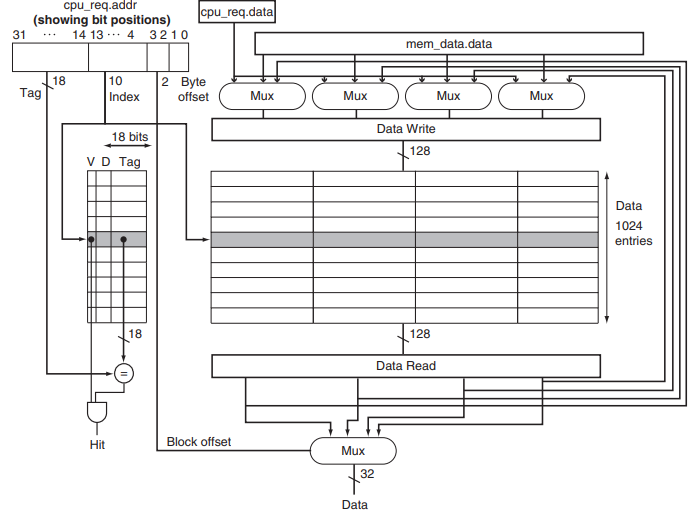
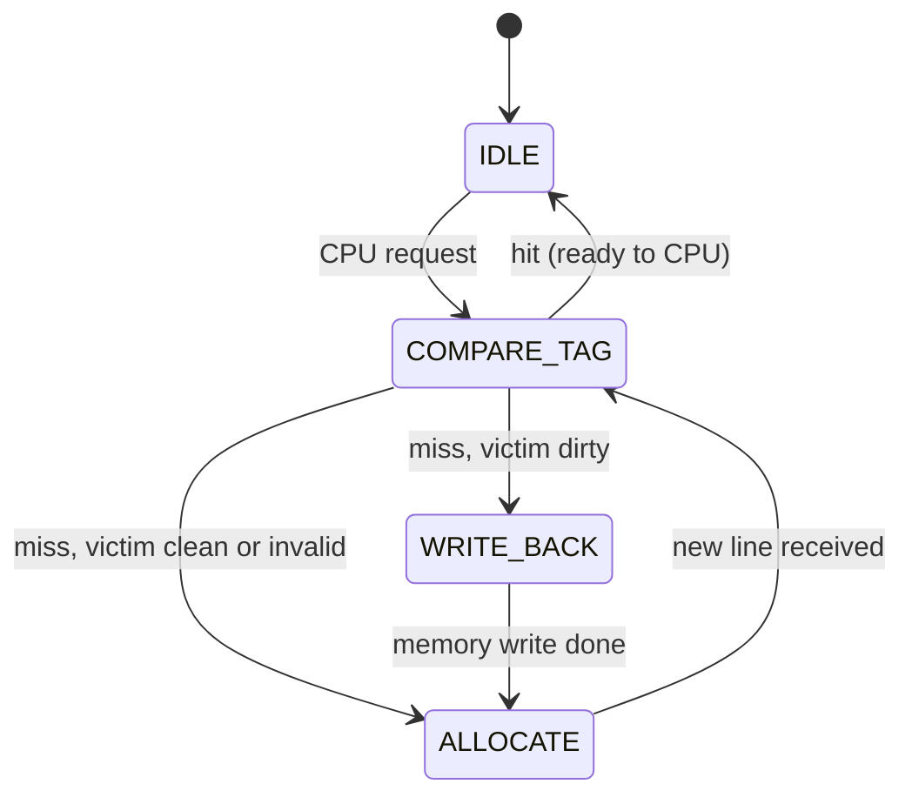
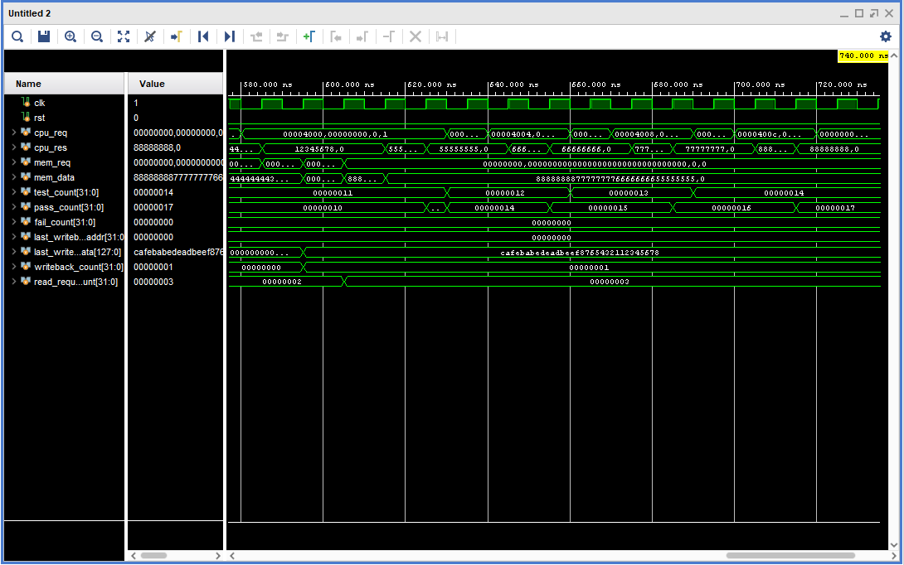

# Direct-Mapped Write-Back Cache — SystemVerilog RTL

A **16 KiB direct-mapped, write-back, write-allocate cache** written in SystemVerilog, verified with a self-checking testbench, and synthesized and implemented on a **Xilinx Zynq-7000 FPGA** in Vivado.

The design follows the cache controller described in *Computer Organization and Design, RISC-V Edition* (Patterson & Hennessy), Chapter 5.

## Key Results

| | |
|---|---|
| **Verification** | 14 / 14 checks passed: 13 directed tests + 1,000 random CPU accesses against a reference model |
| **Random test coverage** | 758 line refills, 462 dirty-line write-backs, 0 mismatches |
| **Target device** | Xilinx Zynq-7000 `xc7z010clg400-1` (Vivado 2023.2) |
| **Timing** | Closed at **100 MHz**: WNS +0.129 ns, WHS +0.241 ns, 0 failing endpoints |
| **Logic** | 2,761 LUTs (393 logic + 2,368 distributed RAM), 4 flip-flops, 0 BRAM, 0 DSP |

## Skills Demonstrated

- RTL design in SystemVerilog: packages, packed/unpacked structs, enums, `always_comb` / `always_ff`
- FSM-based controller design for hit, miss, write-back and refill
- Memory hierarchy concepts: tag/index/offset decoding, valid and dirty bits, write-back and write-allocate policies
- Self-checking verification: behavioral memory model with latency, scoreboard/reference model, directed and constrained-random tests
- FPGA implementation flow: out-of-context synthesis, timing constraints, place and route, utilization and timing analysis

---

## Architecture

| Parameter | Value |
|---|---|
| Organization | Direct-mapped |
| Capacity | 16 KiB data (1024 lines × 128 bits) |
| Line size | 16 bytes (4 × 32-bit words) |
| Address | 32-bit, byte-addressable |
| Write policy | Write-back |
| Write-miss policy | Write-allocate |
| Tag entry | 18-bit tag + valid + dirty = 20 bits |
| CPU interface | 32-bit word read/write, valid/ready handshake |
| Memory interface | 128-bit line read/write, valid/ready handshake |

### Address breakdown

```
 31                 14 13            4 3      2 1      0
┌─────────────────────┬───────────────┬────────┬────────┐
│        TAG          │     INDEX     │  WORD  │  BYTE  │
│      18 bits        │    10 bits    │ 2 bits │ 2 bits │
└─────────────────────┴───────────────┴────────┴────────┘
```

- **Index** selects one of the 1024 lines.
- **Tag** is compared with the stored tag to detect a hit.
- **Word** selects one of the four 32-bit words in the 128-bit line.



### Controller FSM



| State | What happens |
|---|---|
| `IDLE` | Wait for a valid CPU request. |
| `COMPARE_TAG` | Read tag and data at the index. **Hit:** return the word (read) or merge it into the line and set dirty (write). **Miss:** install the new tag and issue a memory request. |
| `WRITE_BACK` | The victim line was dirty: it is sent to memory, then the new line is requested. |
| `ALLOCATE` | Wait for memory to return the line and write it into the data array, then return to `COMPARE_TAG`, which now hits and completes the request. |

A hit completes in **2 clock cycles** (request accepted in `IDLE`, ready in `COMPARE_TAG`).

### RTL modules

| File | Description |
|---|---|
| `cache_def.sv` | Package with all interface types: tag entry, RAM request, CPU request/response, memory request/response |
| `dm_cache_fsm.sv` | Top-level cache controller FSM; instantiates the tag and data arrays |
| `dm_cache_tag.sv` | 1024 × 20-bit tag array (tag, valid, dirty) |
| `dm_cache_data.sv` | 1024 × 128-bit data array |

---

## Verification

The testbench (`Test Bench/cache_controller_tb.sv`) is fully self-checking and prints PASS/FAIL for every test.

- **Memory model:** a behavioral main memory with a 3-cycle latency that serves line reads and records write-backs.
- **Reference model:** tracks the expected value of every word the CPU has written, so every read is checked automatically.

**Directed tests** (13 checks):

1. Read miss on an empty cache fetches the line
2. Read hit causes no memory access
3. Write hit stays in the cache (no memory traffic)
4. Read-back of a word written on a hit
5. Write miss on an empty line fetches the line
6. Write miss merges the word into the fetched line
7. Miss on a dirty line writes it back, then fetches the new line
8. Write-back has the correct address and data
9. Miss on a clean line: earlier write is read back from memory
10. Write miss with a clean victim causes no write-back
11. A line allocated on a write miss is dirty and is written back on eviction
12. That write-back has the correct address and data
13. An evicted write is read back correctly from memory

**Random test:** 1,000 random reads and writes across 4 tags × 4 indexes × 4 words, so hits, conflict misses and evictions all happen often. Every read is compared with the reference model.

```
---- random tests (1000 accesses) ----
      memory reads: 758, write-backs: 462
PASS  random reads all match the reference model

==========================================
  checks: 14   passed: 14   failed: 0
  ALL TESTS PASSED
==========================================
```



---

## FPGA Implementation Results

Synthesized out-of-context and placed and routed in **Vivado 2023.2** on `xc7z010clg400-1` (speed grade -1), with a 100 MHz clock constraint. Full reports are in [`Reports/`](Reports).

### Utilization (post-route)

| Resource | Used | Available | Util % |
|---|---:|---:|---:|
| Slice LUTs | 2,761 | 17,600 | 15.69 |
| ├ LUT as logic | 393 | 17,600 | 2.23 |
| └ LUT as distributed RAM | 2,368 | 6,000 | 39.47 |
| Flip-flops | 4 | 35,200 | 0.01 |
| F7 / F8 muxes | 1,184 / 592 | 8,800 / 4,400 | 13.45 |
| Slices | 822 | 4,400 | 18.68 |
| Block RAM | 0 | 60 | 0 |
| DSP | 0 | 80 | 0 |

### Timing (post-route)

| Metric | Value |
|---|---|
| Clock constraint | 10.000 ns (100 MHz) |
| Worst setup slack (WNS) | +0.129 ns |
| Worst hold slack (WHS) | +0.241 ns |
| Failing endpoints | 0 of 4,744 |

### Analysis

- **Storage maps to distributed RAM.** The tag and data arrays are read asynchronously, so Vivado builds them from 592 `RAM256X1S` cells (2,368 LUTs) instead of block RAM. Only 393 LUTs are control logic.
- **4 flip-flops** hold the FSM state, which Vivado re-encoded as one-hot. All cache storage is in LUT-RAM.
- **Critical path:** tag RAM read → tag compare (`CARRY4`) → data RAM write-enable, which fans out to 176 RAM cells. 7 logic levels; 66% of the delay is routing. This is the single-cycle hit-and-write path.

### Possible improvements

- Register the tag-compare result, or use synchronous-read arrays so the data array maps to block RAM. This frees about 2,400 LUTs and shortens the critical path, at the cost of one extra cycle on a hit.
- Extend to a 2-way or 4-way set-associative cache with LRU replacement.

---

## How to Run (Vivado)

### Simulation

1. Create an **RTL Project** in Vivado (any 7-series part, e.g. `xc7z010clg400-1`).
2. Add the four files in `RTL Code/` as **design sources**.
3. Add `Test Bench/cache_controller_tb.sv` as a **simulation source** and set it as the simulation top.
4. Run **Behavioral Simulation**, then type `run all` in the Tcl Console. The summary appears in the console.

Command line alternative:

```
xvlog -sv "RTL Code/cache_def.sv" "RTL Code/dm_cache_tag.sv" "RTL Code/dm_cache_data.sv" "RTL Code/dm_cache_fsm.sv" "Test Bench/cache_controller_tb.sv"
xelab cache_controller_tb -s cache_sim
xsim cache_sim -runall
```

### Synthesis and implementation

1. Add `Constraints/timing.xdc` as a constraints file.
2. In **Synthesis Settings → More Options**, add `-mode out_of_context`. The module has about 390 port bits, more than the device has pins, so it is implemented as a block without I/O.
3. Run synthesis and implementation, then:

```
report_utilization
report_timing_summary
```

---

## Repository Structure

```
direct-mapped-writeback-cache/
├── RTL Code/
│   ├── cache_def.sv
│   ├── dm_cache_fsm.sv
│   ├── dm_cache_tag.sv
│   └── dm_cache_data.sv
├── Test Bench/
│   └── cache_controller_tb.sv
├── Constraints/
│   └── timing.xdc
├── Reports/
│   ├── utilization_impl.rpt
│   └── timing_impl.rpt
├── Cache_Schematics_WorkingModel/
├── Simulation_Waveforms/
└── README.md
```

## Reference

D. A. Patterson and J. L. Hennessy, *Computer Organization and Design RISC-V Edition: The Hardware/Software Interface*, Chapter 5.

## Author

**Ajeeth** — [GitHub @Ajeeth93](https://github.com/Ajeeth93)
